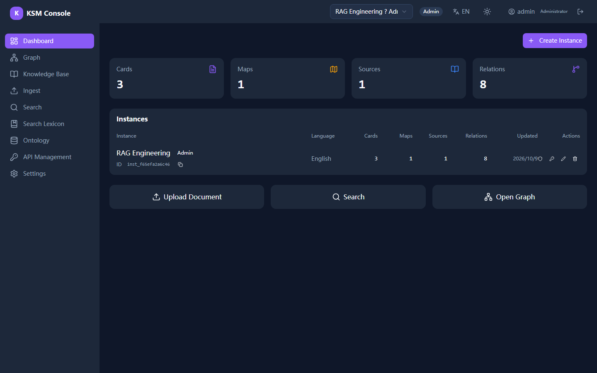
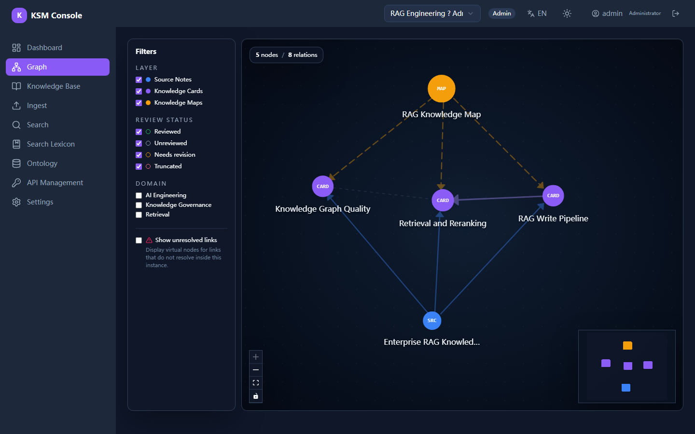
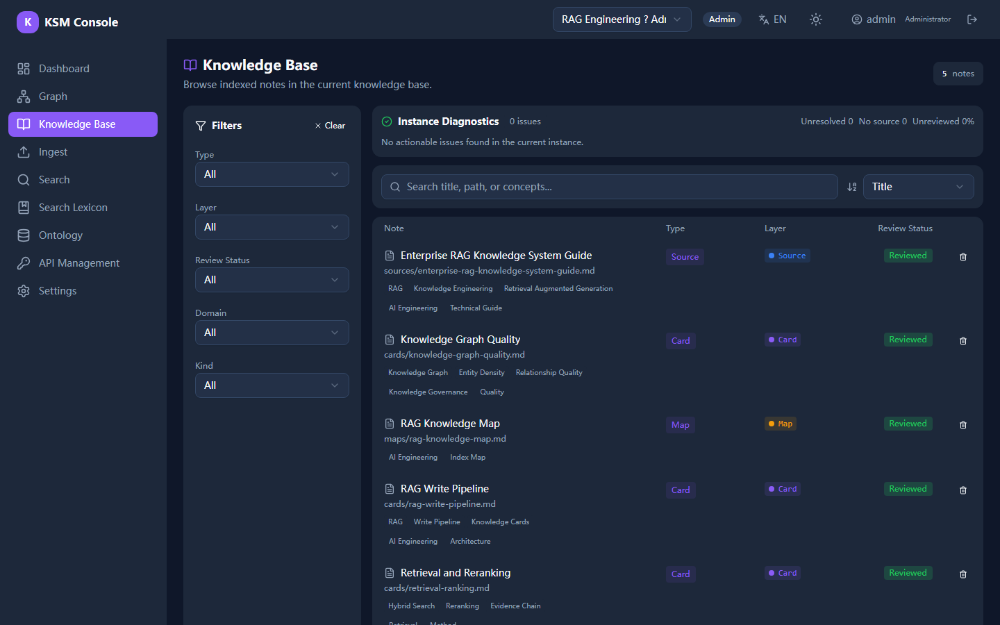
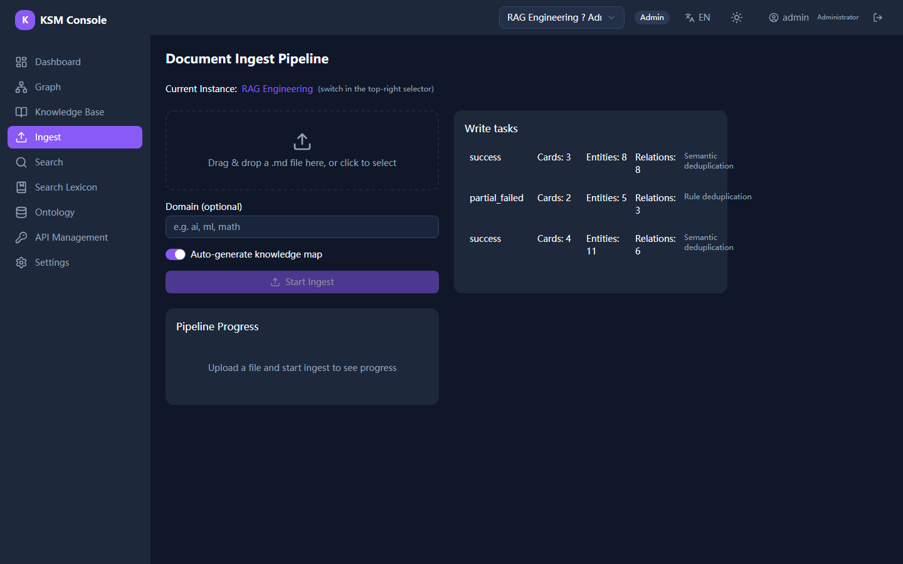
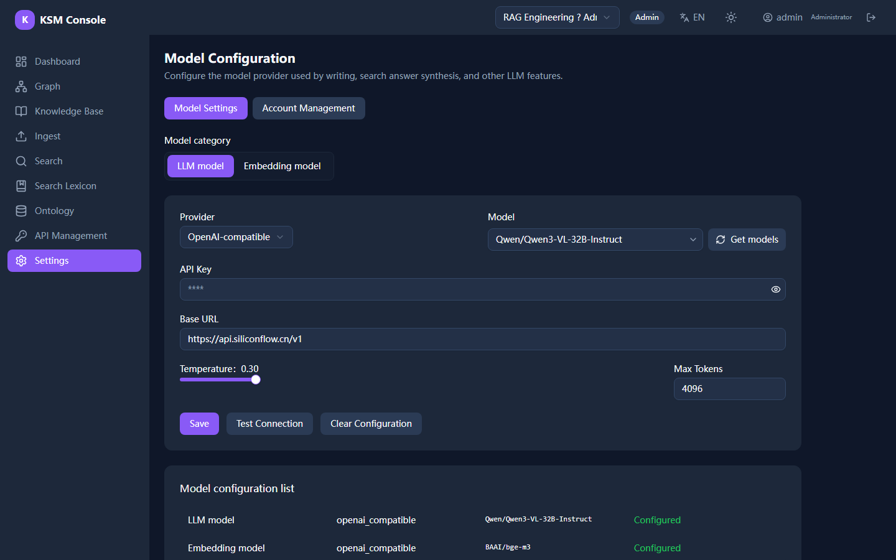

<div align="center">

# KSM — Knowledge Service Module

**Local-first knowledge infrastructure for AI systems, built on Obsidian Vault standard.**

[](LICENSE)
[](https://www.python.org/)
[](https://fastapi.tiangolo.com/)
[](https://react.dev/)

[English](README.md) | [中文](README.zh-CN.md)

</div>

---

<div align="center">
  
</div>

## What is KSM?

KSM is a local-first knowledge service module for AI business systems. It uses Obsidian Vault as the underlying knowledge carrier, processing raw materials into traceable, searchable, and organized structured knowledge nodes through standard directories, frontmatter metadata, Wikilinks, and SQLite indexing.

### Core Capabilities

| Capability | Description |
|------------|-------------|
| **Instance Management** | Create and manage isolated knowledge base instances with standard vault directory structure |
| **Knowledge Writing** | Process Markdown documents into source notes, knowledge cards, and knowledge maps |
| **Async Ingestion** | SSE-powered 8-step pipeline with progress, card/entity/relation metrics, and deduplication status |
| **Write Density Control** | Budget cards, entities, and relations per document so large inputs produce a focused knowledge graph |
| **Model Configuration** | Configure one LLM model and one embedding model from the Web console, including model discovery |
| **Relationship Organization** | Parse and index knowledge relationships (source_trace, extracted_from, concept_overlap, etc.) |
| **Structured Search** | Intent-aware search returning core_hits, related_cards, source_notes, and maps |
| **Knowledge Graph** | Interactive visualization with React Flow, supporting 3-layer filtering |
| **Web Console** | Browser-based UI with Dashboard, Graph View, Ingest, Search, Note Detail, and Settings |
| **Local-First** | All data stored locally in filesystem and SQLite — easy to debug, migrate, and review |

### Tech Stack

| Layer | Technologies |
|-------|-------------|
| **Backend** | Python 3.11+ / FastAPI / SQLite (FTS5) / Local filesystem |
| **Frontend** | React 19 / TypeScript / Vite / Tailwind CSS / shadcn/ui / Zustand / React Flow |

---

## Product Tour

<table>
  <tr>
    <td width="50%"></td>
    <td width="50%"></td>
  </tr>
  <tr>
    <td width="50%"></td>
    <td width="50%"></td>
  </tr>
</table>

---

## Quick Start

### Prerequisites

- Python 3.11+
- Node.js 18+
- API access for one LLM provider and one embedding provider (embedding is recommended; rule-based deduplication is used as a fallback)

### 1. Clone & Setup Backend

```bash
git clone https://github.com/ningQT/KSM.git
cd KSM

python -m venv .venv
source .venv/bin/activate  # Windows: .venv\Scripts\activate

pip install -r requirements.txt
```

### 2. Start Backend

```bash
uvicorn app.api.app:create_app --factory --host 127.0.0.1 --port 8900
```

### 3. Start Frontend

```bash
cd frontend
npm install
npm run dev
```

Open http://localhost:5173 in your browser.

### 4. Configure Models

Open http://localhost:5173/settings and configure:

- **LLM model**: used for writing, answer synthesis, and other model-assisted tasks.
- **Embedding model**: used for semantic deduplication and vector recall.

Model settings are stored in the local database. If no embedding model is configured, ingest continues with rule-based deduplication and shows a warning in the console.

---

## Docker Deployment

```bash
docker compose up -d --build
```

Set the required data, port, and security environment variables for your deployment. Model credentials are configured in the Web console.

---

## API Overview

| Category | Endpoints |
|----------|-----------|
| **Instances** | `POST/GET /api/v1/instances` |
| **Ingestion** | `POST /api/v1/instances/{id}/ingest[/async]` |
| **Search** | `POST /api/v1/search` |
| **Graph** | `GET /api/v1/instances/{id}/graph` |
| **Settings** | `GET/PUT /api/v1/settings/models/{category}` |

Interactive docs (when running): http://127.0.0.1:8900/docs

---

## Web Console

| Page | Path | Description |
|------|------|-------------|
| Dashboard | `/` | Instance list with knowledge statistics |
| Knowledge Base | `/knowledge` | Browse and filter source notes, cards, and maps |
| Graph View | `/graph` | Interactive 3-layer knowledge graph |
| Ingest | `/ingest` | Document upload, SSE progress, and write task metrics |
| Search | `/search` | Structured knowledge search |
| Search Lexicon | `/search-lexicon` | Query expansion and synonym management |
| Ontology | `/ontology` | Entity types, relation types, and graph vocabulary |
| API Management | `/api-management` | API keys and account access control |
| Note Detail | `/note/:path` | Markdown rendering with metadata |
| Settings | `/settings` | LLM and embedding model configuration plus account management |

Supports light/dark theme.

---

## Configuration

LLM and embedding credentials are managed in the Web console at `/settings` and stored in the local database. Runtime infrastructure settings remain environment-driven.

Key environment variables:

| Variable | Required | Default | Description |
|----------|----------|---------|-------------|
| `KSM_DATA_DIR` | No | `./data/vaults` | Data storage directory |
| `KSM_PORT` | No | `8900` | HTTP port |
| `KSM_ENABLE_DOCS` | No | `true` | Enable `/docs` endpoint |

Model credentials are intentionally not managed through `.env`; configure them in the console.

---

## Testing

```bash
# All tests
python -m pytest -q

# Unit tests only
pytest tests/unit/ -v

# Integration tests
pytest tests/integration/ -v

# With coverage
pytest tests/ --cov=app --cov-report=term-missing
```

---

## Project Structure

```
ksm/
├── app/                    # Python backend
│   ├── api/                # FastAPI routes & dependencies
│   ├── core/               # Business services
│   ├── llm/                # LLM client & prompts
│   ├── pipeline/           # Search pipeline
│   ├── storage/            # SQLite + FTS5
│   └── template/           # Vault templates
├── frontend/               # React frontend
│   └── src/
│       ├── components/     # UI components
│       ├── pages/          # Page components
│       ├── services/       # API calls
│       └── stores/         # Zustand state
├── configs/                # Strategy configs
├── templates/              # Vault templates
└── tests/                  # Test suite
```

---

## License

This project is licensed under the MIT License — see [LICENSE](LICENSE) for details.
